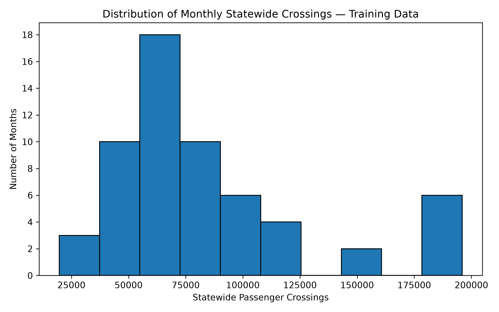
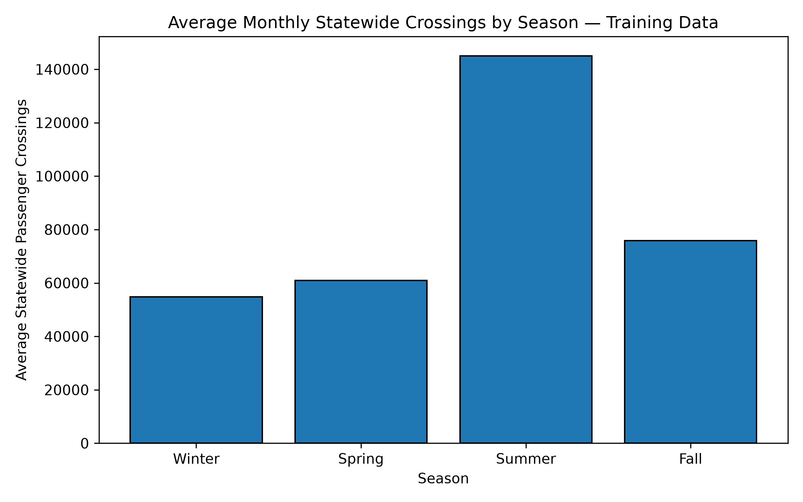
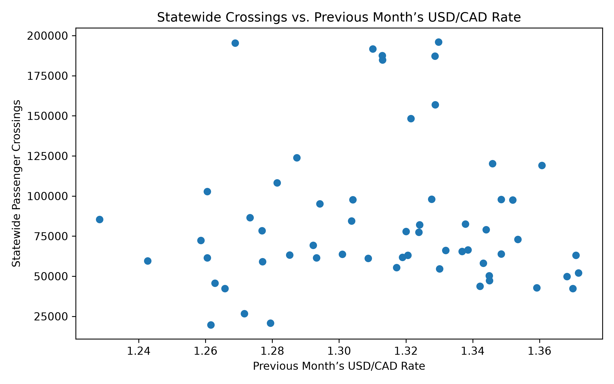
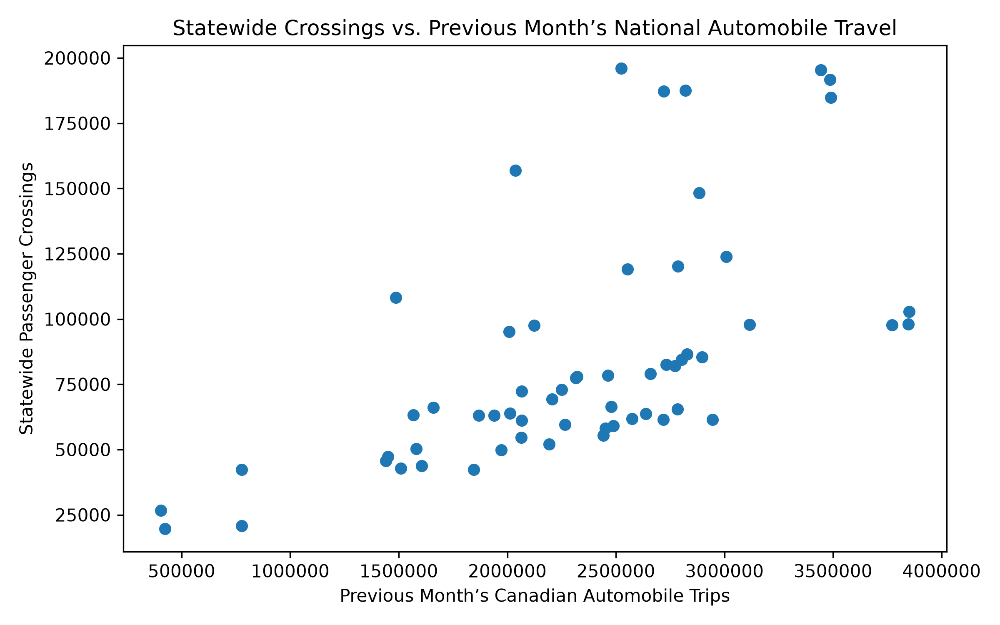

# Model Report: Montana Border Crossings

## Training Data Exploration

These charts and statistics use only the 59 training rows (April 2017 through
December 2023, with March 2020 through December 2021 excluded). The validation
and test rows were not examined. The correlations below describe association
only; they do not establish that any feature causes crossing levels.

| Statistic | statewide_crossings (train) |
| :-------- | --------------------------: |
| Count | 59 |
| Mean | 84,551 |
| Standard deviation | 44,943 |
| Minimum | 19,633 |
| Median | 69,347 |
| Maximum | 195,972 |

| Feature | Correlation with statewide_crossings (train) |
| :------ | -------------------------------------------: |
| crossings_rolling_3 | 0.419 |
| usd_cad_rate_lag1 | 0.018 |
| national_travel_lag1 | 0.607 |

### Distribution of the target

Most training months fall between about 40,000 and 110,000 crossings, but the distribution contains a wide range with a long right tail, where the six highest months (each July and August from 2017 to 2019, at about 185,000–196,000) appear to be seasonal summer peaks.

### Average crossings by season

Summer training months average about 145,000 statewide crossings, roughly 2.6 times the winter average of about 54,800 and well above spring (about 60,900) and fall (about 75,900), which suggests a strong seasonal pattern in Montana crossings.

### Target vs. previous month's exchange rate

Within the narrow range observed in the training data (about 1.23 to 1.37), the previous month’s USD/CAD rate shows little visible relationship with statewide crossings (r = 0.02), although this does not prove that exchange rates cannot affect travel.

### Target vs. previous month's national automobile travel

The previous month’s Canadian automobile trips show the strongest visible numerical relationship with statewide crossings (r = 0.61), but national and Montana travel may both reflect the same seasonal pattern, so this association does not show that national travel drives Montana crossings.
