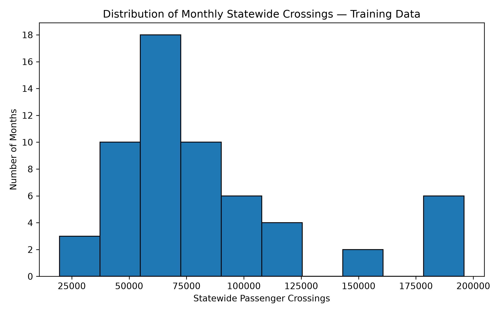
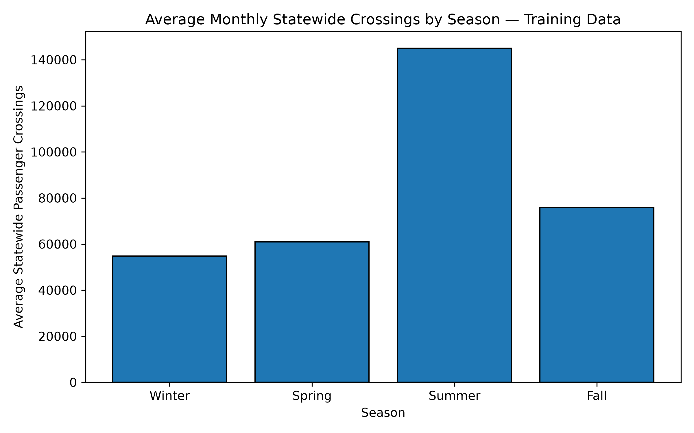
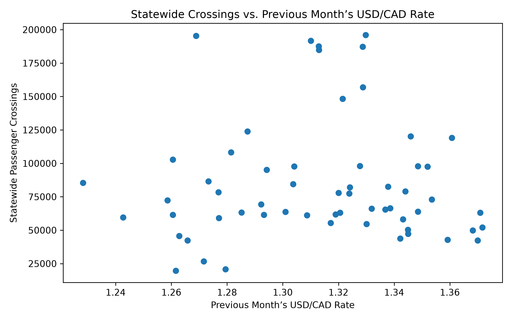
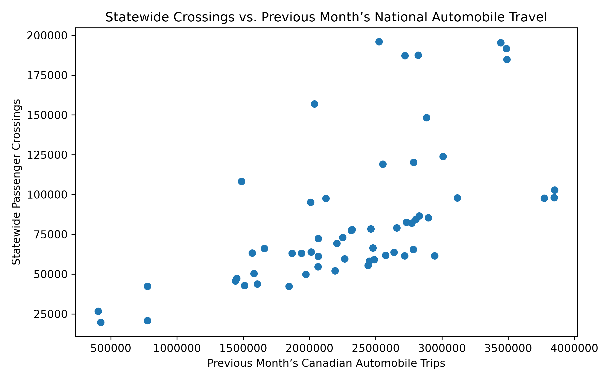

# Model Report: Montana Border Crossings

## Training Data Exploration

These charts and statistics use only the 59 training rows (April 2017 through
December 2023, with March 2020 through December 2021 excluded). The validation
and test rows were not examined. The correlations below describe association
only; they do not establish that any feature causes crossing levels.

| Statistic | statewide_crossings (train) |
| :-------- | --------------------------: |
| Count | 59 |
| Mean | 84,551 |
| Standard deviation | 44,943 |
| Minimum | 19,633 |
| Median | 69,347 |
| Maximum | 195,972 |

| Feature | Correlation with statewide_crossings (train) |
| :------ | -------------------------------------------: |
| crossings_rolling_3 | 0.419 |
| usd_cad_rate_lag1 | 0.018 |
| national_travel_lag1 | 0.607 |

### Distribution of the target

Most training months fall between about 40,000 and 110,000 crossings, but the distribution contains a wide range with a long right tail, where the six highest months (each July and August from 2017 to 2019, at about 185,000–196,000) appear to be seasonal summer peaks.

### Average crossings by season

Summer training months average about 145,000 statewide crossings, roughly 2.6 times the winter average of about 54,800 and well above spring (about 60,900) and fall (about 75,900), which suggests a strong seasonal pattern in Montana crossings.

### Target vs. previous month's exchange rate

Within the narrow range observed in the training data (about 1.23 to 1.37), the previous month’s USD/CAD rate shows little visible relationship with statewide crossings (r = 0.02), although this does not prove that exchange rates cannot affect travel.

### Target vs. previous month's national automobile travel

The previous month’s Canadian automobile trips show the strongest visible numerical relationship with statewide crossings (r = 0.61), but national and Montana travel may both reflect the same seasonal pattern, so this association does not show that national travel drives Montana crossings.

## Evaluation Metric

The target, `statewide_crossings`, is a numeric count, so this is a regression problem. Models will be compared using mean absolute error (MAE): the average absolute difference between actual and predicted monthly crossings. MAE stays in passenger-crossing units, so a nontechnical manager can read it directly, and a lower MAE means better predictions. For example, an MAE of 8,000 means predictions are off by about 8,000 passenger crossings per month on average. MAE will be used to compare the baseline with later models.

## Baseline Model

The baseline predicts the training mean, 84,551 crossings, for every month, using no features. Scored on the 12 validation months (2024), it has an MAE of 33,381 crossings. A later model improves on the baseline only if its validation MAE is lower than 33,381.

## Model Comparison

Three models were trained on the 59 training months using seven features (previous month's exchange rate, national automobile travel and Montana crossings, the three-month rolling average, and three season indicators). Tree depth and leaf size were limited to reduce overfitting on the small training set.

| Model | Validation MAE |
| :---- | -------------: |
| Baseline (training mean) | 33,381 |
| Linear Regression | 19,573 |
| Decision Tree | 13,082 |
| Random Forest | 10,096 |

All three models beat the baseline. Random Forest had the lowest validation MAE, about 70% below the baseline, meaning its 2024 predictions were off by about 10,100 crossings per month on average. These results come from only 12 validation months; the test set has not been used.

## Final Test Result

Random Forest was selected because it had the lowest validation MAE. The same fitted model (trained on the 59 training months only) was then scored once on the 19 test months, January 2025 through July 2026.

| Selected model | Validation MAE (2024) | Test MAE (Jan 2025–Jul 2026) |
| :------------- | --------------------: | ---------------------------: |
| Random Forest | 10,096 | 13,243 |

Test performance was worse: the test MAE was 3,148 crossings (about 31%) higher than the validation MAE. The higher test MAE may reflect changes in Canadian travel patterns during 2025–2026 that were not fully represented in the training data. The test set also contains only 19 months, so a few unusual months can have a noticeable effect on MAE. These are possible explanations and were not tested in this analysis. No model, feature or setting changes were made after viewing the test result.
